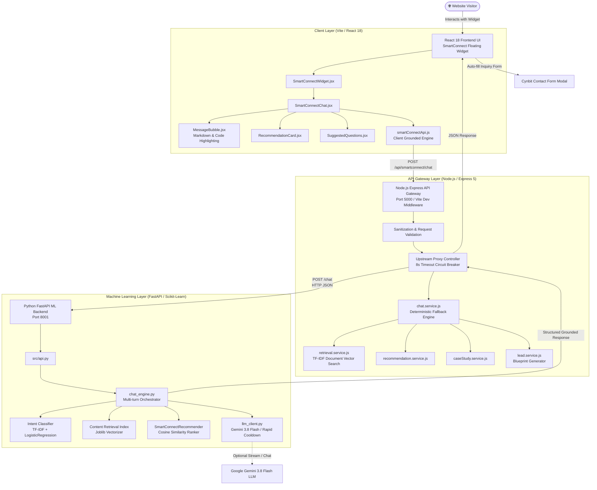
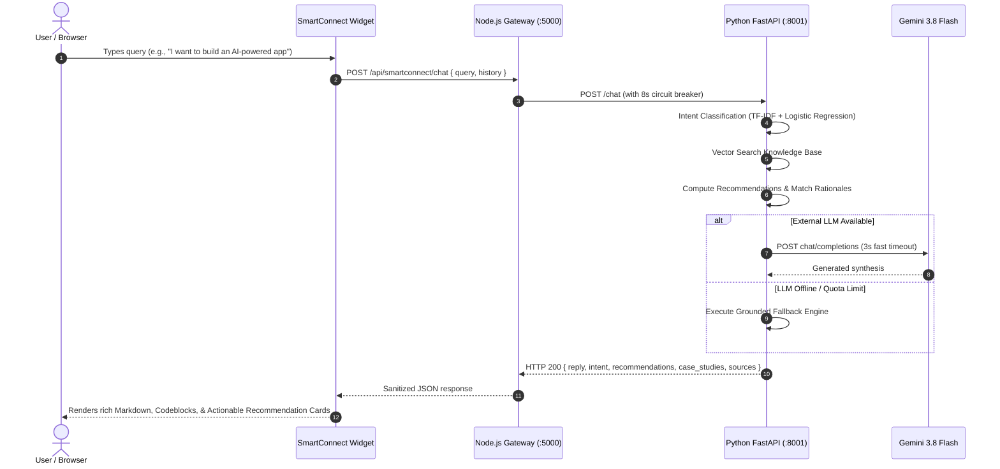

# Cynbit Technologies & SmartConnect AI

[](https://react.dev/)
[](https://vitejs.dev/)
[](https://nodejs.org/)
[](https://fastapi.tiangolo.com/)
[](https://python.org/)
[](https://scikit-learn.org/)
[](https://tailwindcss.com/)
[](#)

A high-performance full-stack web application for **Cynbit Technologies** ([cynbit.in](https://www.cynbit.in/)), featuring **SmartConnect AI** — an integrated conversational customer assistant with machine-learning intent classification, RAG-grounded retrieval, intelligent product recommendations, case-study discovery, and contact inquiry handoff.

---

## 🏛️ System Architecture

SmartConnect AI is built as a resilient 3-tier microservices architecture. It pairs an interactive React floating assistant with a Node.js API Gateway and an asynchronous Python FastAPI ML service, backed by multi-layered grounded fallbacks to guarantee 100% uptime without external API failures or rate limits.

### Architecture Diagram



### End-to-End Request Sequence



---

## 🌟 Core Features of SmartConnect AI

1. **Floating Interactive Widget**: Fixed at the bottom-right corner, non-intrusive, responsive across desktop, tablet, and mobile. Supports expand, minimize, clear conversation, and real-time status badges.
2. **AI-Powered Website Question Answering (RAG)**: Uses verified Cynbit documentation from `/services`, `/products`, `/case-studies`, and company archives. Never invents facts or pricing.
3. **Smart Business Requirement Extraction**: Automatically detects industry domain, core operational bottlenecks, and technological goals from conversational input.
4. **Intelligent Recommendation Engine**: Dynamically matches customer goals to Cynbit service offerings and proprietary products (*TenantEase*, *Revio*, *Cynbit Studio*) with "Why it matches" explanations.
5. **Relevant Case Study Discovery**: Surfaces verified real-world case studies (e.g. *Pragya Healths AI Triage*, *Global Logistics Corp ERP Modernization*) with documented business metrics.
6. **Project Blueprint & Contact Handoff**: Synthesizes structured project specifications and allows one-click transfer into Cynbit's inquiry modal.
7. **Rich Markdown & Code Rendering**: Supports headers, lists, comparison tables, and code snippets with language badges and interactive **Copy Code** functionality.
8. **Multi-layer Fallback Resilience**: If upstream AI providers experience rate-limiting or downtime, deterministic grounded engines in both Python and Node.js immediately serve accurate answers in milliseconds.

---

## 🧭 Page Routes & Directory

| Route | Page | Description |
|---|---|---|
| `/` | **Home** | Hero with foundational pillars, startup speed vs enterprise rigor, and four domain mastery pillars. |
| `/services` | **Services Hub** | Autonomous AI agents, cloud infrastructure, full-stack software, and technical SEO. |
| `/products` | **Product Suite** | Cynbit Studio (developer intelligence), TenantEase (prop-tech), and Revio (review management). |
| `/case-studies` | **Case Studies** | Documented client engagements in healthcare triage, legacy ERP migration, and rural care. |
| `/contact` | **Contact** | Interactive inquiry form, headquarters location (Jaipur, Rajasthan), and communication channels. |
| `/bitelevate` | **BitElevate** | 60-day architectural software engineering and career acceleration program. |
| `/bitelevate/paths` | **Learning Paths** | 16+ core curriculum tracks with filterable domain specifications. |
| `/diaries` | **Student Diaries** | Student journeys from academic theory to architectural mastery. |
| `/blog` | **Blog** | Technical articles on autonomous AI agents and modern engineering practices. |
| `/blog/:slug` | **Blog Post** | In-depth technical breakdown and architecture analysis. |
| `/careers` | **Careers** | Engineering positions, company benefits, and open job roles. |
| `/team` | **Team** | Digital architects, principles, and leadership profiles. |
| `/story` | **Story** | Founding narrative, architectural philosophy, and company timeline. |
| `/impact` | **Social Impact** | Philanthropic initiatives in partnership with Manav Seva Trust. |
| `/privacy` | **Privacy Policy** | Data security and encryption standards. |
| `/terms` | **Terms of Service** | Master engagement agreements and program terms. |
| `/cookies` | **Cookie Policy** | Transparent browser cookie preferences. |
| `/sitemap` | **Sitemap** | Full visual directory of all pages across the platform. |

---

## 🛠️ Project Structure

```
Cynbit/
├── backend/                       # Node.js Express Gateway
│   ├── services/
│   │   ├── chat.service.js        # Conversational orchestration & grounded fallback
│   │   ├── recommendation.service.js # Offering recommendation matrix
│   │   ├── retrieval.service.js   # Document vector indexing & search
│   │   ├── caseStudy.service.js   # Published client case study index
│   │   └── lead.service.js        # Lead blueprint & contact prefill generator
│   └── server.js                  # Express API server & proxy
├── ml_service/                    # Python FastAPI Machine Learning Backend
│   ├── artifacts/
│   │   ├── content_retrieval_index.joblib # Serialized TF-IDF vectorizer
│   │   └── intent_classifier.joblib       # Trained LogisticRegression classifier
│   ├── data/                      # Scraped website content & training datasets
│   ├── src/
│   │   ├── api.py                 # FastAPI endpoints (/chat, /recommend, /search)
│   │   ├── recommendation.py      # Recommender class with cosine similarity
│   │   └── smartconnect/
│   │       ├── chat_engine.py     # Multi-turn conversation engine
│   │       └── llm_client.py      # OpenAI-compatible LLM client with rapid fallback
│   ├── tests/                     # Pytest suite
│   └── requirements.txt           # Python dependencies
├── src/
│   ├── components/
│   │   ├── SmartConnect/          # SmartConnect AI React widget
│   │   │   ├── SmartConnectWidget.jsx
│   │   │   ├── SmartConnectChat.jsx
│   │   │   ├── MessageBubble.jsx
│   │   │   ├── RecommendationCard.jsx
│   │   │   ├── SuggestedQuestions.jsx
│   │   │   ├── SmartConnect.css
│   │   │   └── services/smartConnectApi.js
│   │   ├── Navbar.jsx
│   │   ├── Footer.jsx
│   │   └── JoinModal.jsx
│   ├── pages/                     # 17 complete website page components
│   ├── App.jsx                    # Routing & global state
│   ├── main.jsx                   # React entry point
│   └── index.css                  # Tailwind styles
├── public/                        # Static assets, logos, and icons
├── test_master_everything.cjs     # 34-point exhaustive system test
├── test_smartconnect_e2e.cjs      # 17-scenario conversation E2E test
├── vite.config.js                 # Vite configuration with Express API plugin
└── package.json                   # Node.js dependencies
```

---

## 🚀 Getting Started

### Prerequisites
* **Node.js**: v18.x or v20.x+
* **Python**: v3.10+ (Python 3.11+ recommended)
* **npm** or **pnpm**

---

### Step 1: Install Dependencies

#### Frontend & Node Gateway:
```bash
npm install
```

#### Python ML Service:
```bash
cd ml_service
pip install -r requirements.txt
cd ..
```

---

### Step 2: Configure Environment Variables

Create `.env` in the project root:
```env
PORT=5000
SMARTCONNECT_ML_API_URL=http://127.0.0.1:8001/chat
GEMINI_MODEL=gemini-3.8-flash
```

*(Optional: Add `GEMINI_API_KEY` for live generative responses; otherwise, the built-in grounded fallback engine operates automatically with zero API dependencies).*

---

### Step 3: Run the Application

#### Terminal 1 — Start Python FastAPI ML Backend:
```bash
python -m uvicorn src.api:app --app-dir "ml_service" --host 127.0.0.1 --port 8001 --reload
```
*Endpoint running at:* `http://127.0.0.1:8001`

#### Terminal 2 — Start Node.js API Gateway:
```bash
node backend/server.js
```
*Endpoint running at:* `http://127.0.0.1:5000`

#### Terminal 3 — Start Vite Development Server:
```bash
npm run dev
```
*Application running at:* `http://localhost:3000`

---

## 🧪 Testing & Verification

The project includes an exhaustive multi-level testing suite:

### 1. Run the Master System-Wide Test (34/34 Tests)
Validates all FastAPI endpoints, Node endpoints, all 17 frontend routes, input sanitization, and 10 parallel concurrent requests:
```bash
node test_master_everything.cjs
```

### 2. Run SmartConnect End-to-End Chat Tests (17/17 Tests)
Validates greetings, company questions, general technical queries, and multi-turn context retention:
```bash
npm test
```

### 3. Run Python Unit Tests (7/7 Tests)
Validates ML intent classification, recommendation logic, and vector retrieval:
```bash
python -c "import sys, pytest; sys.path.insert(0, 'ml_service'); sys.exit(pytest.main(['ml_service/tests', '-v']))"
```

### 4. Production Build Test
```bash
npm run build
```

---

## 🔒 Security & Privacy

* **Zero Information Invention**: Grounded strictly in Cynbit Technologies' verified public architecture and documentation.
* **No Client-Side API Keys**: Private configurations and upstream endpoints are encapsulated behind the Node.js API Gateway.
* **XSS & Injection Protection**: HTML sanitization and markdown token escaping prevent arbitrary code execution in chat bubbles.
* **Non-intrusive Integration**: Added as an independent floating widget without altering existing website layouts, routes, typography, or styling.

---

## 📄 License

Proprietary — Engineered for **Cynbit Technologies** ([cynbit.in](https://www.cynbit.in/)). All rights reserved.
